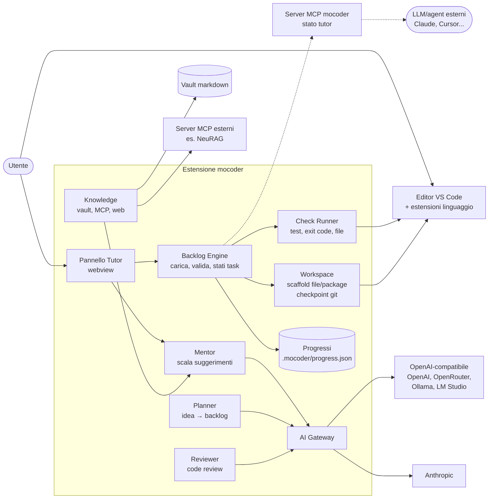

# mocoder — Architettura

> Un tutor che ti fa costruire **a mano** il progetto che hai in testa, task dopo task,
> insegnandoti come si lavora davvero: backlog, branch, test, review, retrospettiva.

## 1. Principio guida

Il valore di mocoder è il **tutoring**, non l'editor. Quindi:

- **Editor, file explorer, terminale, git, debugger, linguaggi → li prendiamo dalla piattaforma.**
- **Backlog, teoria, suggerimenti, controlli, progressi, obiettivi → li scriviamo noi.**

"Prendere in prestito" qui non è rubare: costruiamo **sopra** piattaforme open source
fatte apposta per essere estese (come fanno Cursor, Gitpod, Theia, VSCodium).

## 2. Piattaforma: estensione VS Code (compatibile Open VSX)

| Serve all'utente | Chi lo fornisce | Licenza |
|---|---|---|
| Editor, explorer, ricerca, terminale | VS Code / VSCodium (Code-OSS) | MIT |
| Git, diff, branch | estensione git integrata | MIT |
| Java: package, classi, Maven/Gradle | *Extension Pack for Java* (Red Hat JDT LS) | EPL / MIT |
| Python | Python ext + basedpyright / Jedi | MIT |
| Notebook (analisi dati, BI) | Jupyter integrato | MIT |
| Ambienti riproducibili, lab cybersecurity | Dev Containers (`devcontainer.json`) | standard aperto |
| Versione web / self-hosted (futuro) | Eclipse Theia o code-server | EPL / MIT |

Regole sulle licenze:
- **Dipendere** da un'estensione (o chiamare i suoi comandi) è sempre ok.
- **Copiare codice** MIT/Apache: ok con attribuzione. Codice GPL: non copiarlo (obbliga tutto il progetto a GPL).
- Estensioni proprietarie Microsoft (Pylance, C# Dev Kit, marketplace MS) non si possono usare
  fuori da VS Code: scegliamo sempre alternative aperte, così Theia/VSCodium funzionano.

**Gestione del work tree** (creare file, package Java, scheletri) = API di VS Code
(`workspace.fs`, `WorkspaceEdit`) + comandi dell'estensione Java + `git` per i checkpoint.
Niente workspace manager scritto da zero.

## 3. Schema dei componenti



### Componenti

| Componente | Responsabilità | Note |
|---|---|---|
| **Backlog Engine** | Legge `.mocoder/backlog.yaml`, lo valida con JSON Schema, gestisce gli stati dei task (`locked → available → in_progress → done`) e le dipendenze | Cuore del sistema. Funziona **anche senza IA** |
| **Check Runner** | Esegue i controlli del task (comando di test, file esistente, regex sull'output) tramite Tasks API di VS Code | Il task è "fatto" solo se i controlli passano |
| **Pannello Tutor** | Teoria, obiettivo del task, suggerimenti, progressi, milestone | Webview: HTML + variabili CSS di VS Code; markdown con il renderer di VS Code (`markdown.api.render`) |
| **Mentor** | Suggerimenti a scala: concetto → indizio → frammento → soluzione. Domande socratiche, non risposte | Livello di guida scelto dall'utente, non scritto nel backlog |
| **Planner** | Idea → fattibilità (livello, tempo, versione ridotta) → backlog. Interno via API, oppure "copia prompt" per LLM esterno e import del file | Stesso validatore per entrambe le strade, con ciclo di "riparazione" (max 2 tentativi) |
| **Reviewer** | Review del codice a fine task/milestone contro i criteri del task | Insegna cosa guarda un senior in una PR |
| **Workspace** | Crea gli scheletri dichiarati nel task, un commit per task, branch per milestone | Usa git dell'utente: impara git lavorando |
| **AI Gateway** | Due adattatori: Anthropic + OpenAI-compatibile (copre quasi tutto, Ollama incluso). Chiavi nel `SecretStorage` di VS Code. Contatore token e budget | Modello forte per Planner/Reviewer, economico o locale per i suggerimenti |
| **Knowledge** | Teoria dal vault (cartella markdown, tag nel frontmatter = chiavi `learn` del task). Poi MCP client e web, sempre con fonte citata | Il vault ha la precedenza su internet |
| **Progressi** | Task fatti, competenze, errori ricorrenti, suggerimenti usati, ripasso | JSON per progetto + JSON globale. SQLite solo se servono statistiche tra progetti |
| **Server MCP mocoder** (fase 3) | Espone a LLM esterni `get_current_task`, `get_backlog`, `run_checks`, `get_progress` | Così qualsiasi IA "sa cosa fare e dove" senza uscire dal percorso |

## 4. Insegnare *come si lavora*

Il backlog non è una lista di esercizi: simula il flusso di un team vero.

| Pratica reale | In mocoder |
|---|---|
| Backlog, milestone/sprint | `milestones` nel backlog, obiettivo dichiarato per ognuna |
| Issue con criteri di accettazione | ogni task ha `goal` + `checks` |
| Branch per feature | branch automatico per milestone |
| Commit piccoli e chiari | commit per task, formato Conventional Commits spiegato |
| Test prima del merge | i check devono passare per sbloccare il task successivo |
| Code review | Reviewer a fine milestone, commenti come in una PR |
| Definition of Done | check + review |
| Retrospettiva | a fine milestone: cosa hai imparato, dove hai usato più suggerimenti, ripasso |

### Livelli di guida (impostazione utente, cambiabile in ogni momento)

| Livello | Teoria | Suggerimenti | Scaffold |
|---|---|---|---|
| **Guidato** | sempre visibile | tutti, uno alla volta | file e package creati |
| **Suggerimenti** | su richiesta | limitati, l'ultimo (soluzione) costa | solo struttura |
| **Autonomo** | su richiesta | nessuno, solo review | nessuno |

## 5. Formato del backlog

File: `.mocoder/backlog.yaml` dentro il progetto, versionato in git.
Validato da `schema/backlog.schema.json`.

```yaml
schema: 1
project: registro-presenze
summary: Registro presenze per una classe, da riga di comando a API REST
stack: [java-21, maven, junit-5, sqlite]
env: .devcontainer/devcontainer.json      # opzionale

milestones:
  - id: M1
    title: Dominio e test
    goal: Modellare studenti e presenze con test automatici

tasks:
  - id: T03
    milestone: M1
    title: Classe Studente
    depends_on: [T02]
    goal: Rappresentare uno studente con email valida
    learn: [java-record, validazione, unit-test]   # chiavi verso il vault
    theory: |
      Perché separiamo il modello dalla persistenza...
    files:
      - path: src/main/java/it/presenze/model/Student.java    # file dell'utente, con scheletro opzionale
      - path: src/test/java/it/presenze/model/StudentTest.java
        given: true                                          # fornito, non si modifica
        content: "..."
    hints:
      - "Un record Java è ideale per dati immutabili"
      - "Valida nel compact constructor"
      - "if (!email.contains(\"@\")) throw new IllegalArgumentException(...)"
    checks:
      - run: mvn -q test -Dtest=StudentTest
    review: [naming, immutabilità, messaggi di errore chiari]
```

Esempio completo e verificato: `examples/registro-presenze/.mocoder/backlog.yaml`
(validazione e check: `python tools/verify_backlog.py <backlog> --solution <cartella>`).

Rischio da gestire: **test generati dall'IA sbagliati**. L'utente resterebbe bloccato senza colpa.
Contromisura (fase 2): il Planner genera anche una soluzione di riferimento nascosta e i check
vengono eseguiti su quella prima di consegnare il backlog. Più un pulsante "check sbagliato?"
che manda il caso al Reviewer.

## 6. Flussi principali

**Creazione progetto**
1. L'utente descrive l'idea e il proprio livello.
2. Planner: fattibile? Tempo stimato? Versione ridotta per partire?
3. Genera il backlog (interno) oppure dà il prompt da incollare in un LLM esterno → import file.
4. Validazione schema → riparazione automatica se serve.
5. Creazione repo, devcontainer, primo commit.

**Ciclo del task**
1. Il pannello mostra obiettivo e teoria, l'editor apre il file del task.
2. L'utente scrive codice e chiede suggerimenti quando serve (registrati nei progressi).
3. "Verifica" → Check Runner → esito spiegato.
4. Verde → commit, task successivo sbloccato. Rosso → il Mentor spiega l'errore senza dare la soluzione.

**Fine milestone** → review → merge del branch → retrospettiva → ripasso.

## 7. Stack

| Area | Scelta | Perché |
|---|---|---|
| Linguaggio | TypeScript | è il linguaggio delle estensioni VS Code |
| Build | esbuild | standard per le estensioni, un comando |
| UI pannello | HTML + variabili CSS VS Code, `markdown.api.render` | tema chiaro/scuro gratis, niente framework né librerie markdown |
| YAML / schema | `yaml`, `ajv` | librerie standard e mature |
| IA | `@anthropic-ai/sdk` + endpoint OpenAI-compatibile via `fetch` | due adattatori coprono cloud e locale |
| MCP | `@modelcontextprotocol/sdk` | client per il vault, server per esporre lo stato |
| Segreti | `SecretStorage` di VS Code | portachiavi del sistema operativo |
| Test | `node:test` sul core (Node esegue TypeScript direttamente) | la logica sta lì, zero dipendenze di test |
| Distribuzione | VS Code Marketplace + Open VSX | Open VSX serve per VSCodium/Theia |

## 8. Struttura del repository

```
mocoder/
  docs/ARCHITETTURA.md
  schema/backlog.schema.json   backlog + $defs/solution
  prompts/planner.md            (mentor.md, reviewer.md in fase 2)
  examples/
    registro-presenze/.mocoder/ backlog.yaml + solution.yaml   (Java)
    analisi-spese/.mocoder/     backlog.yaml + solution.yaml   (Python)
  extension/
    src/core/        backlog, workspace, checks, progress, verify  (puro, testato)
    src/cli/         verify: schema + rosso/verde da riga di comando
    src/view.ts      HTML del pannello
    src/extension.ts comandi, pannello, git
    (src/ai/, src/knowledge/ arrivano in fase 2-3)
```

## 9. Roadmap

| Fase | Contenuto | Verifica che funzioni |
|---|---|---|
| **0 — Carta** ✅ | Schema + prompt Planner + un backlog d'esempio generato con un LLM esterno e seguito **a mano** | Il percorso insegna davvero? Prima di scrivere codice |
| **1 — MVP** ✅ | Estensione: backlog, pannello, check, suggerimenti dal file, progressi, commit per task, import della risposta di un LLM esterno, verifica rosso/verde. **Nessuna IA a runtime** | Un utente completa il registro presenze in Java |
| **2 — IA** | Gateway (BYOK + Ollama), Planner interno, Mentor dinamico, Reviewer, (la verifica sulla soluzione di riferimento esiste già) | Da un'idea nuova a un backlog funzionante senza interventi |
| **3 — Conoscenza** | Vault, MCP client, server MCP mocoder, ripasso a intervalli | La teoria arriva dalle tue note |
| **4 — Domini** | Template per web, data/BI (notebook), cybersecurity (lab in container, solo bersagli locali), architettura | Un percorso completo per dominio |
| **5 — Ovunque** | Versione web (Theia/code-server), app telefono per teoria/quiz/progressi, sincronizzazione | Studio dal telefono, codice al PC |

## 10. Fuori scope (per ora)

- Editor proprio, file manager proprio, terminale proprio.
- Backend/server centrale e account utente: tutto è locale finché non arriva la fase 5.
- Esecuzione del codice sul telefono.
