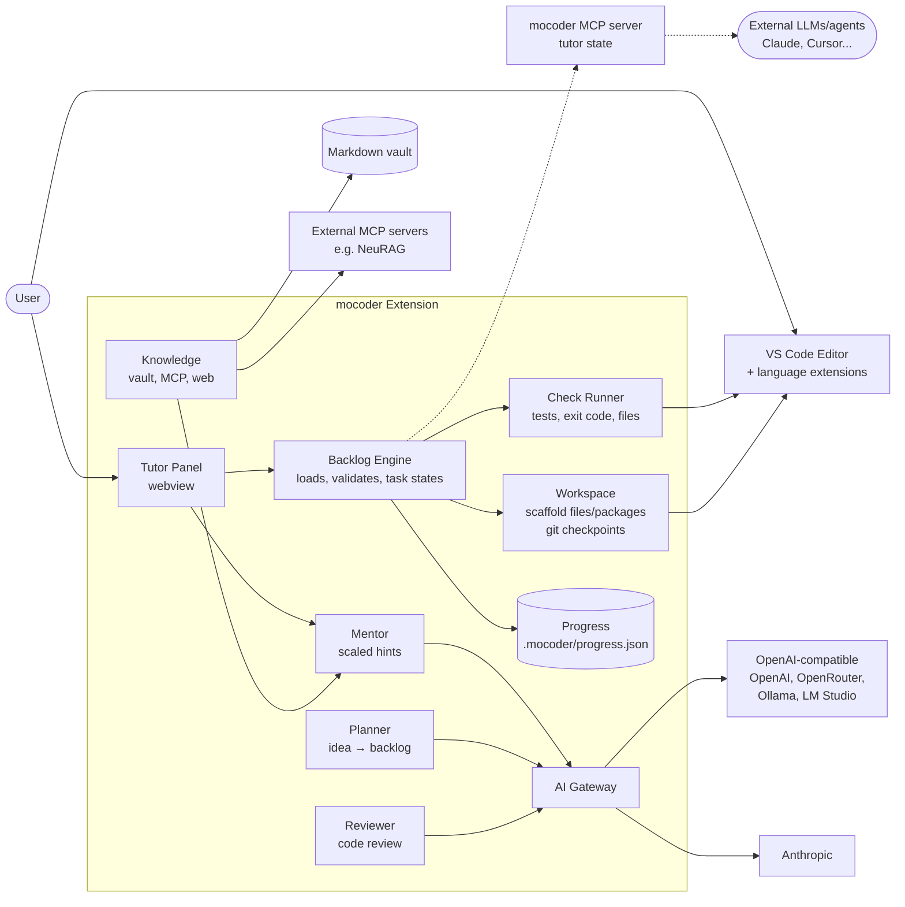

# mocoder — Architecture

> A tutor that makes you build **by hand** the project you have in mind, task after task,
> teaching you how work is really done: backlog, branches, tests, review, retrospective.

## 1. Guiding principle

The value of mocoder is the **tutoring**, not the editor. So:

- **Editor, file explorer, terminal, git, debugger, languages → we take them from the platform.**
- **Backlog, theory, hints, checks, progress, goals → we write them ourselves.**

"Borrowing" here is not stealing: we build **on top of** open source platforms
made to be extended (as Cursor, Gitpod, Theia, VSCodium do).

## 2. Platform: VS Code extension (Open VSX compatible)

| What the user needs | Who provides it | License |
|---|---|---|
| Editor, explorer, search, terminal | VS Code / VSCodium (Code-OSS) | MIT |
| Git, diff, branch | built-in git extension | MIT |
| Java: packages, classes, Maven/Gradle | *Extension Pack for Java* (Red Hat JDT LS) | EPL / MIT |
| Python | Python ext + basedpyright / Jedi | MIT |
| Notebooks (data analysis, BI) | built-in Jupyter | MIT |
| Reproducible environments, cybersecurity labs | Dev Containers (`devcontainer.json`) | open standard |
| Web / self-hosted version (future) | Eclipse Theia or code-server | EPL / MIT |

License rules:
- **Depending** on an extension (or calling its commands) is always ok.
- **Copying** MIT/Apache code: ok with attribution. GPL code: do not copy it (it forces the whole project to GPL).
- Proprietary Microsoft extensions (Pylance, C# Dev Kit, MS marketplace) cannot be used
  outside VS Code: we always choose open alternatives, so that Theia/VSCodium work.

**Work tree management** (creating files, Java packages, skeletons) = VS Code APIs
(`workspace.fs`, `WorkspaceEdit`) + Java extension commands + `git` for checkpoints.
No workspace manager written from scratch.

## 3. Component schema



### Components

| Component | Responsibility | Notes |
|---|---|---|
| **Backlog Engine** | Reads `.mocoder/backlog.yaml`, validates it with JSON Schema, manages task states (`locked → available → in_progress → done`) and dependencies | Heart of the system. It works **even without AI** |
| **Check Runner** | Runs the task checks (test command, existing file, regex on the output) through the VS Code Tasks API | The task is "done" only if the checks pass |
| **Tutor Panel** | Theory, task goal, hints, progress, milestones | Webview: HTML + VS Code CSS variables; markdown with the VS Code renderer (`markdown.api.render`) |
| **Mentor** | Scaled hints: concept → hint → snippet → solution. Socratic questions, not answers | Guidance level chosen by the user, not written in the backlog |
| **Planner** | Idea → feasibility (level, time, reduced version) → backlog. Built-in via API, or "copy prompt" for an external LLM and file import | Same validator for both roads, with a "repair" cycle (max 2 attempts) |
| **Reviewer** | Code review at the end of a task/milestone against the task criteria | Teaches what a senior looks at in a PR |
| **Workspace** | Creates the skeletons declared in the task, one commit per task, branch per milestone | Uses the user's git: you learn git by working |
| **AI Gateway** | Two adapters: Anthropic + OpenAI-compatible (covers almost everything, Ollama included). Keys in the VS Code `SecretStorage`. Token counter and budget. No intermediary: no token resold by mocoder | Strong model for Planner/Reviewer, cheap or local for the hints. Three roads proposed in the panel: no account (web chatbot), free API (Gemini), pay-as-you-go API (DeepSeek) |
| **Knowledge** | Theory from the vault (markdown folder, tags in the frontmatter = the task's `learn` keys). Then MCP client and web, always with a cited source | The vault takes precedence over the internet |
| **Progress** | Tasks done, skills, recurring errors, hints used, review | JSON per project + global JSON. SQLite only if cross-project statistics are needed |
| **mocoder MCP server** (phase 3) | Exposes to external LLMs `get_current_task`, `get_backlog`, `run_checks`, `get_progress` | So any AI "knows what to do and where" without leaving the path |

## 4. Teaching *how work is done*

The backlog is not a list of exercises: it simulates the flow of a real team.

| Real practice | In mocoder |
|---|---|
| Backlog, milestone/sprint | `milestones` in the backlog, a declared goal for each |
| Issue with acceptance criteria | every task has `goal` + `checks` |
| Branch per feature | automatic branch per milestone |
| Small, clear commits | one commit per task, Conventional Commits format explained |
| Tests before merge | the checks must pass to unlock the next task |
| Code review | Reviewer at the end of a milestone, comments as in a PR |
| Definition of Done | check + review |
| Retrospective | at the end of a milestone: what you learned, where you used the most hints, review |

### Guidance levels (user setting, changeable at any time)

| Level | Theory | Hints | Scaffold |
|---|---|---|---|
| **Guided** | always visible | all of them, one at a time | files and packages created |
| **Hints** | on request | limited, the last one (solution) costs | structure only |
| **Autonomous** | on request | none, review only | none |

## 5. Backlog format

File: `.mocoder/backlog.yaml` inside the project, versioned in git.
Validated by `schema/backlog.schema.json`.

```yaml
schema: 1
project: registro-presenze
summary: Attendance register for a class, from command line to REST API
stack: [java-21, maven, junit-5, sqlite]
env: .devcontainer/devcontainer.json      # optional

milestones:
  - id: M1
    title: Domain and tests
    goal: Model students and attendance with automated tests

tasks:
  - id: T03
    milestone: M1
    title: Student class
    depends_on: [T02]
    goal: Represent a student with a valid email
    learn: [java-record, validation, unit-test]   # keys to the vault
    theory: |
      Why we separate the model from persistence...
    files:
      - path: src/main/java/it/presenze/model/Student.java    # user file, with optional skeleton
      - path: src/test/java/it/presenze/model/StudentTest.java
        given: true                                          # provided, not modified
        content: "..."
    hints:
      - "A Java record is ideal for immutable data"
      - "Validate in the compact constructor"
      - "if (!email.contains(\"@\")) throw new IllegalArgumentException(...)"
    checks:
      - run: mvn -q test -Dtest=StudentTest
    review: [naming, immutability, clear error messages]
```

Complete and verified example: `examples/registro-presenze/.mocoder/backlog.yaml`
(validation and checks: `python tools/verify_backlog.py <backlog> --solution <folder>`).

Risk to manage: **AI-generated tests that are wrong**. The user would be stuck through no fault of their own.
Countermeasure (phase 2): the Planner also generates a hidden reference solution and the checks
are run on it before delivering the backlog. Plus a "wrong check?" button
that sends the case to the Reviewer.

## 6. Main flows

**Project creation**
1. The user describes the idea and their level.
2. Planner: feasible? Estimated time? Reduced version to start?
3. It generates the backlog (built-in) or gives the prompt to paste into an external LLM → file import.
4. Schema validation → automatic repair if needed.
5. Repo creation, devcontainer, first commit.

**Task cycle**
1. The panel shows the goal and theory, the editor opens the task's file.
2. The user writes code and asks for hints when needed (recorded in the progress).
3. "Verify" → Check Runner → explained outcome.
4. Green → commit, next task unlocked. Red → the Mentor explains the error without giving the solution.

**End of milestone** → review → branch merge → retrospective → review.

## 7. Stack

| Area | Choice | Why |
|---|---|---|
| Language | TypeScript | it is the language of VS Code extensions |
| Build | esbuild | standard for extensions, one command |
| Panel UI | HTML + VS Code CSS variables, `markdown.api.render` | free light/dark theme, no framework or markdown library |
| YAML / schema | `yaml`, `ajv` | standard, mature libraries |
| AI | `@anthropic-ai/sdk` + OpenAI-compatible endpoint via `fetch` | two adapters cover cloud and local |
| MCP | `@modelcontextprotocol/sdk` | client for the vault, server to expose the state |
| Secrets | VS Code `SecretStorage` | operating system keychain |
| Tests | `node:test` on the core (Node runs TypeScript directly) | the logic lives there, zero test dependencies |
| Distribution | VS Code Marketplace + Open VSX | Open VSX is needed for VSCodium/Theia |

## 8. Repository structure

```
mocoder/
  docs/ARCHITETTURA.md
  schema/backlog.schema.json   backlog + $defs/solution
  prompts/                      planner.md, mentor.md, reviewer.md
  examples/
    registro-presenze/.mocoder/ backlog.yaml + solution.yaml   (Java)
    analisi-spese/.mocoder/     backlog.yaml + solution.yaml   (Python)
    broken/.mocoder/            fails on purpose: verification and diagnostics test
  extension/
    src/core/        backlog, workspace, checks, progress, verify  (pure, tested)
    src/cli/         verify: schema + red/green from the command line
    src/view.ts      panel HTML
    src/extension.ts commands, panel, git
    src/ai/          providers (Anthropic SDK, OpenAI-compatible, budget), roles (Planner, Mentor, Reviewer)
    (src/knowledge/ arrives in phase 3)
```

## 9. Roadmap

| Phase | Content | Proof it works |
|---|---|---|
| **0 — Paper** ✅ | Schema + Planner prompt + an example backlog generated with an external LLM and followed **by hand** | Does the path really teach? Before writing code |
| **1 — MVP** ✅ | Extension: backlog, panel, checks, hints from the file, progress, one commit per task, import of an external LLM's answer, red/green verification. **No AI at runtime** | A user completes the attendance register in Java |
| **2 — AI** ✅ | Gateway (Claude via the official SDK with fallback on refusals, any OpenAI-compatible API, Ollama), keys in the keychain, monthly token budget, built-in Planner with automatic correction (max 2), Socratic Mentor that does not receive the solution until the student opens it, Reviewer per task and milestone | From a new idea to a working backlog with no intervention |
| **3 — Knowledge** | Vault, MCP client, mocoder MCP server, spaced review | The theory comes from your notes |
| **4 — Domains** | Templates for web, data/BI (notebooks), cybersecurity (labs in containers, local targets only), architecture | A complete path per domain |
| **5 — Everywhere** | Web version (Theia/code-server), phone app for theory/quiz/progress, synchronization | Study from the phone, code on the PC |

## 10. Out of scope (for now)

- Our own editor, our own file manager, our own terminal.
- Central backend/server and user accounts: everything is local until phase 5 arrives.
- Running the code on the phone.
